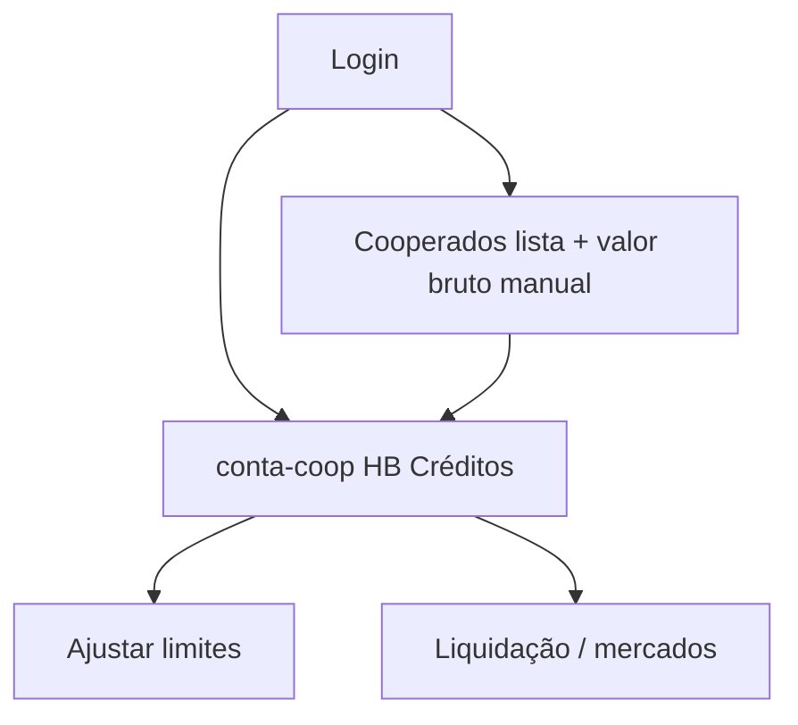

# Fluxos responsável — ponta a ponta (estado atual)

Referência adicional: `docs/diagnostico/RESPONSAVEL-PONTA-A-PONTA-2026.md`.

## 1. Entrada

1. Mesmo `/login` (e-mail/senha `app_users`).
2. `resolveAppUserRole` → `responsavel` / `tesoureiro` / diretoria.
3. Redirect `/dashboard` (painel gestão).
4. `CooperativaSyncProvider` + `staffGestaoAberturaHydrate` (CNPJ, contadores).

## 2. Conferir entregas (`/notas-pedido`)

- Fila por cooperado/mês; conferir nota → impacta valor a pagar.
- **Acoplamento HB:** crédito base pode usar dados financeiros conferidos.

## 3. Pagar cooperados (`/ficha-corrida`)

- Quitação por mês; integra **abatimento HB Créditos** nas notas.
- APIs: `cooperativa-sync/registrar-pagamento`, `confirmar-pagamento`.

## 4. Livro caixa (`/livro-caixa`)

- Movimentos caixa físico; integridade com pagamentos.

## 5. HB Créditos (`/conta-coop`) — núcleo V2 responsável

Arquivo UI: `ContaCoopContent.tsx` (~milhares de linhas). Abas típicas:

| Área | Função |
|------|--------|
| **Limites** | Liberar limite por cooperado; % crédito base |
| **Mercados** | Parceiros, chave PIX, desconto contratual |
| **Operação** | Transações, estornos, fila cloud |
| **Liquidação / NF** | Conferir notas fiscais mercado |
| **PIN reset** | Fila pedidos cooperado |

APIs principais:

- `GET/POST /api/credit/limites`
- `GET /api/credit/dashboard`
- `GET /api/credit/account` (visão staff)
- `POST /api/credit/sync-limite`
- Storage: `src/lib/supabase/contaCoopStorage.ts`

## 6. Cooperados (`/cooperados`)

- Lista, cadastro, vínculo `app_users`.
- **V2:** manter + campo **valor bruto manual** para crédito base.

## 7. Relatórios / fechamento / contador

- `R5 — Extrato HB Créditos` em relatórios contador.
- Fora do escopo V2 inicial (pode export CSV mínimo depois).

## Fluxo V2 responsável (alvo)

## O que não fazer na V2 sem substituto

- Cortar `/api/credit/*` ou `contaCoopStorage`.
- Apagar `cooperados` sem manter IDs usados em `hb_credit_accounts`.
