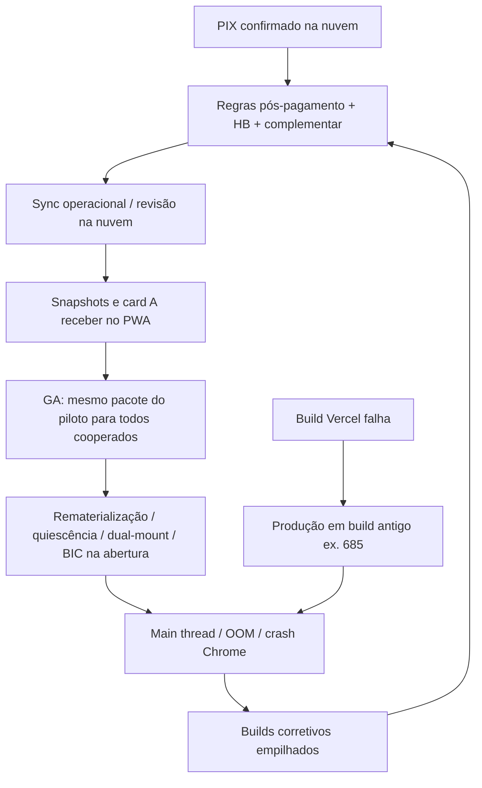

# Marco zero — instabilidade após o primeiro pagamento

**Programa operacional (fases, pilares, constituição):** [`docs/plano-mestre/MARCO-ZERO-PROGRAMA-2026.md`](../plano-mestre/MARCO-ZERO-PROGRAMA-2026.md)

Documento de auditoria e diagnóstico (read-only sobre dados; análise de código e histórico de release).  
**Cooperativa piloto:** CoopeagriPla — CNPJ `62351750000165`.  
**Piloto cooperado:** Jeferson — `jefersonabreudeaguiar@gmail.com`, `c_1781981564381_w67gg`.

**Atualizado:** 2026-10-26  
**Relatório de nuvem (passo 1):** ver `MARCO-ZERO-AUDITORIA-2026-10-26.md` (gerado no mesmo dia).

---

## 1. Pergunta que este documento responde

Por que, **depois do primeiro pagamento real**, o app cooperado (e em parte o responsável) **pareceu nunca mais estabilizar** — tela branca, travamento, crash do Chrome, “A receber” zerado ou errado — mesmo com dezenas de builds de correção?

---

## 2. Resumo executivo

| Fato | Conclusão |
|------|-----------|
| Antes do PIX em produção | Grafo simples: ficha + notas conferidas; poucos estados pós-liquidação. |
| Após o primeiro PIX confirmado | **Estado persistente na nuvem** (`pagamentosCooperado`, fichas pagas, livro caixa, arquivo mensal, recibo, complementar, HB no mercado). |
| Resposta do software | Centenas de commits (build ~238 → ~691): regras em `notaPedidoService`, sync operacional, snapshots PWA, GA “experiência Jeferson para todos”, quiescência, rematerialização. |
| Rollback de código | **Não** restaura dados; **não** devolve PWA/localStorage; tag v644 ≠ app bit-a-bit com operacional de 2026. |
| **Marco zero (raiz)** | Cruzamento **dados pós-pagamento** + **regras multi-fonte** + **camada de performance/sync empilhada** sem linha de produto congelada e homologada ponta a ponta. |

O primeiro pagamento **não “quebrou o banco”** sozinho: ele **ativou** um modo de operação que o código ainda estava aprendendo a ler de forma consistente em **responsável, cooperado, BIC/HB e PWA**.

---

## 3. Dois marcos (não confundir)

### Marco A — negócio (campo)

- Primeiro(s) **pagamento(s) cooperado** confirmados na cooperativa real.
- Efeitos em `operacional.json`: `pagamentosCooperado`, `fichaCorrida` (pago/parcial), `livroCaixa`, `arquivosMensais`, vínculo nota ↔ pagamento.
- Runbook: [`docs/RUNBOOK-POS-PAGAMENTOS.md`](../RUNBOOK-POS-PAGAMENTOS.md).  
- Fila conferência vs dinheiro: [`docs/FILA-RESPONSAVEL-VS-FINANCEIRO.md`](../FILA-RESPONSAVEL-VS-FINANCEIRO.md).

### Marco B — software (complexidade e releases)

| Faixa (indicativa) | Tema |
|--------------------|------|
| ~238–240 | Recibo pós-PIX, quitar ficha, verificação “marco zero” operacional |
| ~361+ | Alinhar “a receber” responsável com ficha após PIX |
| ~429 | Anti–sync storm HB (`rollback/pre-hb-sync-storm-429`) |
| ~437+ | Contratos / Pagar responsável |
| ~493–494, v644 | Piloto mobile Jeferson Fase 3 (tag `cooperado-mobile-fase3-v644`) |
| 378+ | `isCooperadoMobileGaPromoted` — mesma UX pesada do piloto para **todo** `role === cooperado` |
| 684–691 | Quiescência, shell de abertura, complementar pós-PIX (688), snapshot-first (690–691), typecheck que bloqueou deploy (685 vs main) |

Referências: [`docs/changelog/cooperado-por-build.md`](../changelog/cooperado-por-build.md), [`docs/release/COOPERADO-JEFERSON-VS-PRODUCAO.md`](../release/COOPERADO-JEFERSON-VS-PRODUCAO.md), [`docs/ARQUITETURA.md`](../ARQUITETURA.md), [`docs/ROLLBACK_POINTS.md`](../ROLLBACK_POINTS.md).

**Marco zero operacional para decisão = A + B.**

---

## 4. O que o primeiro pagamento mudou no modelo de dados

Fonte canônica de desenho: [`docs/ARQUITETURA.md`](../ARQUITETURA.md).

Depois do pagamento, “quanto o cooperado recebe” deixa de ser só soma de ficha pendente:

1. **Escopo do PIX** — só notas/fichas ligadas ao `pagamentoId` contam como cobertas; o resto do mês pode ser **complementar**.
2. **Mês “liquidado”** — regras que evitam reabrir indevidamente, mas que **erraram** quando trataram o mês inteiro como quitado (corrigido com testes em `scripts/test-cooperado-financeiro-guard.ts`, build 688).
3. **HB Créditos** — ciclo após liquidação (`hbCreditCicloAposLiquidacao`), descontos em arquivo mensal, paridade BIC.
4. **Recibo / assinatura** — estados intermediários (`aguardando_confirmacao` vs `confirmado`).

Qualquer sync que traga operacional **parcialmente** atualizado gera sintomas opostos: zero indevido, valor fantasma, ou UI que recalcula em loop.

---

## 5. Por que a instabilidade pareceu crônica (cadeia causal)

### 5.1 Camada UX/performance (não apaga dados, mas derruba o app)

- Promoção GA: [`src/lib/cooperado/cooperadoMobilePilot.ts`](../../src/lib/cooperado/cooperadoMobilePilot.ts) — `isCooperadoMobileGaPromoted`.
- Aparelho “quente” (snapshots) vs “frio” (sync na abertura): [`docs/release/COOPERADO-JEFERSON-VS-PRODUCAO.md`](../release/COOPERADO-JEFERSON-VS-PRODUCAO.md).
- Builds 684–687: quiescência de aba/abertura; **685** marcou quiescência no render (piorou até 687).
- **689–690:** `viewLive` + idle; mobile sem dual-mount fixo em parte do caminho.
- **690–691:** snapshot-first de novo para GA; fix TS em `useCooperadoInicioValorReceberCardState.ts` para destravar Vercel.

### 5.2 Camada regra financeira (dados corretos na nuvem, leitura errada no app)

- `notaPedidoService`: `fichaCobertaPorPagamentoCooperativa`, `getResumoValorAPagarRelatorio`, complementar pós-PIX.
- Piloto: [`docs/pilot/COOPERADO-JEFERSON-STATUS.md`](../pilot/COOPERADO-JEFERSON-STATUS.md).

### 5.3 Fratura de deploy

- `main` avançou enquanto produção ficou em build anterior por **falha de `npm run build`** — usuário testa código que não está no ar.

---

## 6. Por que “backup exato” não voltou ao início

| Expectativa | Realidade |
|-------------|-----------|
| `restore:cooperado-backup-code` (v644) | Restaura **slice cooperado**; mantém gestão, `dataStore`, arquivos pós-tag. |
| Nuvem | Pagamentos e fichas pagas **permanecem** — obrigatório manter regras pós-PIX. |
| PWA | Service worker + `localStorage` misturam eras de build. |
| Filosofia | Rollback de código ≠ rollback de dados — [`docs/FILOSOFIA-PRODUCAO.md`](../FILOSOFIA-PRODUCAO.md). |

**Voltar só o código pré-pagamento com operacional atual = regressão de valores**, não “app como no dia 1”.

---

## 7. O que NÃO é a raiz sozinha

- E-mail do Jeferson (piloto vs GA — negócio não bifurca por e-mail).
- Uma única linha de splash ou quiescência (sintoma amplificado).
- “Só cache” sem divergência de regra (cache piora, mas o grafo pós-pagamento é o terreno).

---

## 8. Linha estável alvo (sem apagar cooperados nem operacional)

Princípios:

1. **Congelar contrato de dados** — `npm run test:cooperado-financeiro`, `gate:preservar-app`, paridade responsável quando aplicável.
2. **Composição de código** — UI/sync de referência: tag `cooperado-mobile-fase3-v644` + patches **só** de regra financeira comprovados (ex. complementar 688, abertura 691).
3. **Responsável** — baseline documentada em [`docs/plano-mestre/LIDERANCA-RESPONSAVEL-2026.md`](../plano-mestre/LIDERANCA-RESPONSAVEL-2026.md).
4. **Nuvem** — auditoria read-only → repair **apenas** se R$ divergirem ([`RUNBOOK-POS-PAGAMENTOS.md`](../RUNBOOK-POS-PAGAMENTOS.md)).
5. **Produção** — `npm run build` + `npm run confirm:production:wait` antes de declarar alinhamento.

---

## 9. Passo 1 — auditoria read-only (protocolo)

Ordem executada em 2026-10-26 (CNPJ piloto):

1. `npx tsx scripts/audit-contadores-alinhamento-once.ts 62351750000165` — painel × relatório a pagar.
2. `npx tsx scripts/audit-todos-relatorios-alinhamento.ts 62351750000165` — cruzamento responsável × cooperado × ficha (substitui script ausente `audit-a-receber-vs-ficha-once.ts` referenciado em `run-weekly-audits.ts`).
3. `npx tsx scripts/audit-hb-base-vs-valor-receber.ts 62351750000165` — HB base × valor a receber.
4. `npx tsx scripts/audit-hb-limites-ghost.ts` — limites fantasma HB.

**Nota técnica:** `scripts/audit-a-receber-vs-ficha-once.ts` está listado em `run-weekly-audits.ts` mas **não existe** no repositório; o passo 2 acima cobre a mesma intenção até o script ser recriado.

Resultados consolidados: **`MARCO-ZERO-AUDITORIA-2026-10-26.md`**.

Nenhum script acima altera `operacional.json` nem apaga cooperados.

---

## 10. Homologação humana (portão final)

Checklist SIM/NÃO (não substituído por commit):

- Responsável: conferir → lançar → pagar → relatório em aberto.
- Cooperado: Início (card), abas, Financeiro, Entregas — após limpar dados do site **ou** PWA atualizado.
- Piloto Jeferson em produção com build confirmado (`confirm:production:wait`).

---

## 11. Reauditoria em 2026-10-30 — valores nota × ficha

Consulta somente leitura à cooperativa: 26 cooperados, 346 notas e 408 fichas. Foram encontradas 51 divergências em notas e fichas com status pago; em todas, a ficha tem bruto e líquido menor que a nota. Cada nota tem uma ficha, nenhum vínculo aponta para outro cooperado/tenant, não há divisão registrada, e todas as 51 notas estão explicitamente vinculadas a pagamento.

A rotina `reconciliarFichaFromNotasConferidas` foi executada apenas em memória sobre a cópia lida: não mudou o bruto de nenhuma nota nem ficha, e as 51 divergências permaneceram. Nenhum valor remoto foi reparado.

### Causa identificada

- Em **51/51** casos, o bruto da ficha está a até 1,5% do total da nota dividido pela quantidade de fotos enviadas.
- Em **51/51** casos, o identificador e a descrição da única ficha correspondem à **última foto (N/N)**. A ficha tem quantidades menores que a nota; os itens da nota somam exatamente o total aprovado.
- Os casos foram criados entre 2026-08-06 e 2026-10-07. Os eventos de aprovação disponíveis são de setembro e não há ajuste posterior ao pagamento.
- Isso identifica a falha histórica como perda das partes anteriores ao concluir uma conferência multi-foto; não é uma divisão entre cooperados, colisão de tenant ou deduplicação na leitura do JSON operacional. O histórico do código confirma a sequência: `f128ba92` registra que o responsável mantinha as partes multi-foto somente em memória e que o sync apagava o progresso; `a4c13c9c` depois corrigiu a aprovação da última foto pendente.
- A versão atual persiste os lançamentos por foto na ficha e, na aprovação, percorre todos os índices. As correções estão no histórico do código em 2026-10-06. Como uma nota divergente foi criada em 2026-10-07 e o histórico de implantação para aquela data ainda não está disponível, a confirmação de quando a correção chegou à produção depende do Vercel e da validação no piloto.

### Validação e contenção

- O smoke de conferência apontava para `NotasPedidoStaffMain.tsx`, que hoje é apenas um arquivo de compatibilidade. Corrigi-o para ler a implementação efetiva em `staff/NotasPedidoStaffResponsavelApp.tsx` e verificar a gravação de todos os índices, inclusive a última foto.
- Incluí o smoke e o teste de conservação multi-foto no `release:verify:fast`.
- `npm run release:verify:fast` passou (22 passos). A verificação opcional de ambiente oficial sinalizou que este checkout é `lab-mirror`, sem as flags de produção; por isso não serve para publicar.
- Os 51 casos são notas já pagas. A nota contém o total agregado, mas não preserva a divisão original dos itens por foto; por isso nenhuma reconstrução financeira remota foi aplicada. Qualquer reparo precisa ser conferido no piloto, preservar os vínculos e status de pagamento e validar contra os pagamentos confirmados.
- A auditoria Supabase foi somente leitura. A equipe Vercel continua indisponível nesta sessão (`list_teams` retornou zero equipes), então piloto e produção não foram publicados nem verificados.

## 12. Histórico deste documento

| Data | Ação |
|------|------|
| 2026-10-26 | Criação do diagnóstico marco zero + execução passo 1 (auditoria nuvem) |
| 2026-10-30 | Auditoria read-only detalhada; causa multi-foto isolada; smoke corrigido e incluído no gate rápido |
