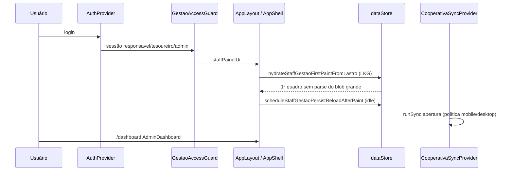
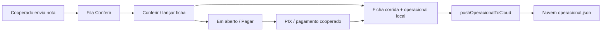

# Diagnóstico ponta a ponta — gestão (responsável)

**Escopo:** papéis `responsavel`, `tesoureiro`, `admin` — painel da cooperativa no browser/PWA.  
**Fora do escopo:** fluxo cooperado (app mobile, entregas, financeiro cooperado) — só citado onde há fronteira compartilhada (sync API, `AppData`).

**Produção (referência):** https://hbcooperativas.vercel.app — conferir build em `/api/client-release`.  
**Repo local (26/10/2026):** build **659** no código; último commit publicado pode estar em **658** até novo push — compare SHA live vs `appBuildVersion.ts`.

---

## 1. Quem é o “responsável” no sistema

| Papel | UI | Acesso |
|--------|-----|--------|
| `responsavel` | Painel gestão | Conferir, ficha, pagar, contratos, equipe |
| `tesoureiro` | Idem | + rotas financeiras conforme permissões |
| `admin` | Idem + plataforma | Conforme `usePermissions` |

**Contrato de identidade:** `src/lib/responsavel/responsavelIdentidade.ts` (`RESPONSAVEL_IDENTIDADE_VERSION`).  
Define `staffPainelUi`, `canGestao`, `showAdminPainel` — evita cooperado JWT virar menu gestão no celular.

**Abertura do painel:** `evaluateResponsavelPainelAbertura` em `responsavelPainelContrato.ts` → `DashboardContent` escolhe `AdminDashboard` dentro de `StaffPainelSafeRoot`.

**Rotas mínimas do shell (cold):** `/dashboard`, `/notas-pedido`, `/ficha-corrida` (`STAFF_SHELL_MIN_HREFS`).

---

## 2. Fluxo de entrada (login → primeira tela)



**Pontos críticos:**

1. **Primeiro paint:** `hydrateStaffGestaoFirstPaintFromLastro()` usa **last good** (`peekStaffGestaoLastGood`) — não parseia `localStorage` inteiro na hora.
2. **Persist:** leitura/merge do arquivo por CNPJ no **idle** (`reloadStaffGestaoPersistAfterFirstPaint`).
3. **Redirect primeiro dia:** cooperativa vazia pode ir a Contratos (`staffPrimeiroDia`).

---

## 3. Onde os dados moram (3 camadas)

| Camada | O quê | Chave / artefato |
|--------|--------|------------------|
| **Memória** | `AppData` ativo | `dataStore` (`memoryCache`) |
| **Last good (LKG)** | Snapshot por CNPJ anti-wipe | `hb-staff-gestao-lkg-v1` + `staffGestaoSnapshotGuard` |
| **Persist disco** | JSON completo | **`coopeagriplla_data:<CNPJ>`** (gestão) |
| **Legado cooperado** | Não usar na gestão | `coopeagriplla_data` (global) |

**Lei:** gestão **não grava** no blob global (`staffGestaoNuncaGravaBlobGlobal`).  
**Troca de CNPJ:** `staffGestaoTenantSwitch` esvazia memória do tenant anterior.

**Erro comum de diagnóstico:** script F12 que lia só `coopeagriplla_data` mostrava **0 MB / 0 fichas** com dados reais em `coopeagriplla_data:62351750000165`. Versão corrigida: `scripts/console/diagnostic-travamento-sync.js`.

---

## 4. Sincronização (gestão)

### 4.1 Tiers (HX 8.4)

Arquivo: `src/lib/performance/syncPlan84.ts`

| Tier | Pull notas | Pull operacional (PIX/ficha/livro) | Uso típico gestão |
|------|------------|-------------------------------------|-------------------|
| `pulse` | não | não | Leve (perfil, cooperados cadastro) |
| `notas_delta` | sim | não | F5 quente, fila |
| `financeiro_delta` | não | sim | Aparelho sem PIX/livro local |
| `operacional_full` | sim | sim + bidirecional | **Atualizar** manual |

Política de abertura: `staffResponsavelOpeningSyncRequest` (`staffResponsavelSyncPolicy.ts`).

- **Mobile:** frio → `financeiro_delta` force; quente → `notas_delta`.
- **Desktop (código):** abertura retorna `pulse`, mas **perfil v2** pode **desligar sync automático de abertura** no PC.

### 4.2 Orquestração

- **`CooperativaSyncProvider`:** `runSync()` — pull tiered, pós-sync `ensureOperacionalAlinhadoComNuvem` (só alerta se restore na nuvem).
- **`requestSyncTier`:** fila de sync; respeita `staffGestaoPausaTrabalhoPesadoAutomatico` (troca de rota).
- **Push operacional:** `pushOperacionalToCloud` após lançar/conferir — falha **500** se payload grande (limite ~5 MB operacional).

### 4.3 Perfil desktop (contrato único)

Arquivo: `src/lib/staff/staffGestaoPerfilDesktop.ts` — versão **`STAFF_GESTAO_DESKTOP_PERFIL_VERSION`**.

Viewport PC: `!isStaffMobileViewportActive()` (≥1024px). Atributo HTML: `data-staff-gestao-perfil=desktop|mobile`.

| Comportamento | Mobile gestão | PC gestão (perfil v2) |
|---------------|---------------|------------------------|
| Live sync loop | sim | **não** |
| Fila catch-up background | sim | **não** |
| Poll Conferir automático | sim | **não** (Atualizar na tela) |
| Sync automático (`runSync`) | conforme política | **bloqueado** (só `userInitiated` / `eventDriven`) |
| Sync na abertura | sim | **não** |
| Reload persist idle | ~180 ms | **~12 s** |
| Prefetch rotas menu | agressivo | **~12 s**, sem hover import |
| HB Créditos warmup staff | sim | **não** |
| Reconciliar livro no Início/Notas | subscribe em cada mudança | **desligado**; só `/livro-caixa` |

**Causa raiz de travamento (comprovada no código):** `useReconciliarLivroCaixaGestao` fazia `subscribe(AppData)` + reconciliação pesada a cada mudança — no PC, o reload do persist disparava **loop** na thread principal → Chrome “página não responde”. Correção v2: sem subscribe no desktop; reconciliar só na rota Livro Caixa.

---

## 5. Navegação e performance de UI

| Ambiente | Abas | Mecanismo |
|----------|------|-----------|
| **Mobile gestão** | Início, Notas, Ficha, … | `StaffMobileTabKeepAlive` + otimista opcional |
| **PC gestão** | Menu lateral `Link` Next.js | **Sem** keep-alive; URL = rota real |
| **PC** | Troca de rota | `markStaffTabPathChange` → pausa sync ~2,4 s |

Arquivos: `AppLayout.tsx`, `staffDesktopNavPolicy.ts`, `staffTabSwitchQuiescence.ts`.

Prefetch: `staffNavPrefetch.ts` — mobile `scheduleStaffNavPrefetchEarly`; desktop `scheduleStaffNavPrefetchDesktop` (leve, atrasado).

---

## 6. Telas principais e leitura de dados

| Rota | Componente | Índice / serviço |
|------|------------|------------------|
| `/dashboard` | `AdminDashboard` | `getAdminStatsCached`, worker opcional (`rqlAdminStats85`) |
| `/notas-pedido` | `NotasPedidoStaffResponsavelApp` | `responsavelPainelIndex`, fila conferência, poll mobile |
| `/ficha-corrida` | `FichaCorridaContent` | ficha + push operacional em ações |
| `/cooperados` (Pagar) | `CooperadosContent` | paridade Em aberto × Pagar (`responsavelGestaoLeitura`) |
| `/livro-caixa` | `LivroCaixaContent` | reconciliação contábil |
| `/contratos` | Contratos staff | primeiro dia |

**`responsavelPainelIndex.ts`:** cache por `dataRevision` — fila, cooperados a pagar, relatório em aberto; pode chamar `reconciliarFichaFromNotasConferidas` na leitura (custo CPU).

**Conferir:** nomes operacionais via `resolverNomeCooperadoGestao` / ficha / nota — não depende só de `cooperados[]` vazio na API.

---

## 7. Fluxo do dia (negócio)



**Contratos travados (preservar-app):**

- Nota só sai da fila no lançamento correto.
- Em aberto e Pagar: **mesmo valor** (paridade v500).
- Atualizar não zera snapshot (v497/v498).
- Correções conferência não liquidam indevido.

---

## 8. Problemas conhecidos (evidência)

| Sintoma | Hipótese / evidência | Trilha |
|---------|----------------------|--------|
| PC “não responde” ao abrir/navegar | Loop reconciliar livro + sync/prefetch competindo | T1 — perfil desktop v2 |
| Build antigo no browser (ex. 656) | Cache SW / sem Ctrl+F5 | Operacional |
| Diag F12 com tudo zero | Chave errada `coopeagriplla_data` | Diagnóstico |
| Em aberto = 0 após F5 | F5 quente `notas_delta` sem reconciliar ficha perdida | T2 — forensic F5 |
| POST cooperativa-sync 500 | Operacional > ~5 MB ou lock 423 | T3 |
| Nomes “Cooperado” na fila | Cadastro vazio local, nome só da nota/ficha | T2 |
| Homolog API: 0 cooperados, 309 fichas nuvem | Cadastro não no slice; operacional rico | T2/T3 |

**Forensic F5 (script):** `scripts/diag-responsavel-f5-forensic.ts` — CNPJ homolog `62351750000165`: após pull sem notas locais, Em aberto zera; com notas + reconciliar recupera.

---

## 9. Verificação automatizada (sem cooperado)

```bash
npm run responsavel:verify:fase-r    # lançamento + desktop + homolog read-only
npm run responsavel:verify:lancamento
npm run gate:preservar-app           # inclui contratos responsável
```

Testes desktop recentes:

- `test-staff-gestao-perfil-desktop.ts` (perfil v2)
- `test-staff-desktop-nav-policy.ts`
- `test-staff-desktop-abertura-leve.ts`
- `test-responsavel-em-aberto-latch-pos-sync.ts`
- `test-conferencia-fila-filtro.ts`

Documentos de método: `docs/plano-mestre/METODO-GESTAO-PC-2026.md`, `LIDERANCA-RESPONSAVEL-2026.md`, checklist `FASE-R-RESPONSAVEL-CHECKLIST.md`.

---

## 10. Investigação no browser (responsável logado)

1. **Build:** `fetch('/api/client-release').then(r=>r.json()).then(console.log)`
2. **Perfil:** `document.documentElement.getAttribute('data-staff-gestao-perfil')` → esperado `desktop` no PC.
3. **Script completo:** colar `scripts/console/diagnostic-travamento-sync.js` → `copy(JSON.stringify(window.__HB_DIAG_SYNC__, null, 2))`.
4. **Chaves local:** Application → Local Storage → todas `coopeagriplla_data*`.
5. **Travamento:** Performance → long tasks; Network → `cooperativa-sync` POST Response.

---

## 11. Mapa de arquivos (gestão)

| Área | Caminhos |
|------|----------|
| Identidade / shell | `responsavelIdentidade.ts`, `responsavelPainelContrato.ts`, `GestaoAccessGuard.tsx`, `AppLayout.tsx` |
| Dados locais | `dataStore.ts`, `staffGestaoPersistKey.ts`, `staffGestaoSnapshotGuard.ts` |
| Sync | `CooperativaSyncProvider.tsx`, `staffResponsavelSyncPolicy.ts`, `cooperativaSyncCloudService.ts` |
| Perfil PC | `staffGestaoPerfilDesktop.ts`, `staffGestaoModoDesktop.ts` |
| Conferir / notas | `NotasPedidoStaffResponsavelApp.tsx`, `responsavelPainelIndex.ts` |
| Valores / pagar | `responsavelGestaoLeitura.ts`, `CooperadosContent.tsx`, `relatorioService.ts` |
| Integridade | `useReconciliarLivroCaixaGestao.ts`, `pagamentoIntegridadeService.ts` |
| Changelog builds | `docs/changelog/responsavel-por-build.md` |

---

## 12. Portões SIM/NÃO (sua homologação)

Ordem recomendada (**T1 antes de T2**):

**T1 — PC vivo**

1. Build atual (≥658/659) visível após Ctrl+F5.  
2. Login gestão abre sem “página não responde”.  
3. Menu Início → Notas → Ficha → Livro em sequência.

**T2 — Dados**

4. Atualizar 1× traz dados sem zerar.  
5. Em aberto = Pagar (mesmo total).  
6. Conferir: nomes alinhados à ficha/nota.

**T3 — Nuvem**

7. Conferir/lançar sem POST 500 recorrente.

---

## 13. Próximo passo técnico (agente, só gestão)

1. Publicar **build 659** (perfil desktop v2 + fix reconciliar) se ainda não estiver live.  
2. Com T1 **SIM**, implementar **reconciliar ficha na abertura/F5** sem operacional_full automático (forensic F5).  
3. Manter cooperado **intocado**.

*Documento gerado para análise; não altera runtime.*
