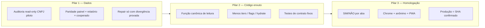

# Programa Marco Zero — estabilização pós-primeiro pagamento

**Autoridade:** liderança do produto (plena) · **Piloto dados:** CoopeagriPla `62351750000165` · **Piloto cooperado:** Jeferson  
**Produção:** https://hbcooperativas.vercel.app · **Atualizado:** 2026-10-27

---

## Tese (uma frase)

Depois do primeiro pagamento, o app passou a viver em **estado pós-liquidação na nuvem**; em vez de estabilizar **uma regra de leitura** e **uma linha de UI**, o projeto acumulou **camadas de sync e performance** — e às vezes **nem publicou o fix** — por isso a sensação de que nunca mais ficou estável. O marco zero é esse cruzamento; a cura é **dados auditados + código enxuto + homologação**, não voltar o relógio ignorando os PIX já registrados.

---

## O que é o marco zero (e o que não é)

| É | Não é |
|---|--------|
| Cruzamento **Marco A** (PIX real na nuvem) + **Marco B** (complexidade de software) | “Um bug único” ou “só cache” |
| Ponto a partir do qual **toda leitura financeira** deve respeitar pagamento parcial, complementar, HB | Rollback de `operacional.json` ou apagar pagamentos |
| **Contrato** de como medir se o app está certo (auditoria + testes + SIM/NÃO) | Mais um build de “sync na abertura” sem remover o anterior |
| Base para **congelar** superfícies uma a uma | Reescrever o app do zero |

Diagnóstico profundo: [`docs/diagnostico/MARCO-ZERO-POS-PAGAMENTO.md`](../diagnostico/MARCO-ZERO-POS-PAGAMENTO.md)  
Auditoria nuvem (2026-10-26): [`docs/diagnostico/MARCO-ZERO-AUDITORIA-2026-10-26.md`](../diagnostico/MARCO-ZERO-AUDITORIA-2026-10-26.md)  
Runbook campo: [`docs/RUNBOOK-POS-PAGAMENTOS.md`](../RUNBOOK-POS-PAGAMENTOS.md)

---

## Constituição do programa (regras invioláveis)

1. **PIX confirmado na nuvem é fato** — código e UI adaptam-se; dados não são “desfeitos” para agradar tela.
2. **Uma leitura canônica por número** — painel, relatório e card do cooperado devem derivar da **mesma função** (ou teste de paridade explícito).
3. **Uma linha de UI por superfície** — proibido recalcular o mesmo R$ em hook + sync + snapshot sem contrato.
4. **Nenhuma entrega sem trilho** — `build` + `confirm:production:wait` + checklist humano SIM/NÃO (não basta commit).
5. **Orçamento de sync** — cada nova política de abertura/idle/hydrate exige **remover ou desligar** uma política equivalente (documentar no PR).
6. **Dois trilhos paralelos** — **gestão** e **cooperado** com gates separados; não misturar “conserto do ícone” com “paridade Pagar” no mesmo pacote sem homologar os dois.

---

## Três pilares da cura



### Pilar 1 — Dados auditados (verdade antes de UI)

| Ordem | Comando | O que valida |
|-------|---------|----------------|
| 1 | `npx tsx scripts/audit-contadores-alinhamento-once.ts 62351750000165` | Gestão: a pagar painel × relatório |
| 2 | `npx tsx scripts/audit-todos-relatorios-alinhamento.ts 62351750000165` | Cruzamento responsável × cooperado × ficha |
| 3 | `npx tsx scripts/audit-hb-base-vs-valor-receber.ts 62351750000165` | HB base × card a receber |
| 4 | `npx tsx scripts/audit-hb-limites-ghost.ts` | Limites fantasma HB |

**Cadência:** antes de cada fase abaixo + semanal (`run-weekly-audits` quando aplicável).  
**Repair na nuvem:** só via runbook, com evidência de R$ divergente — nunca “sync empurrou snapshot vazio”.

### Pilar 2 — Código enxuto (parar de empilhar)

| Manter / reforçar | Congelar / reduzir |
|-------------------|---------------------|
| Funções em `responsavelPainelIndex`, `staffGestaoPainelLeitura`, guards cooperado financeiro | Novos `*Hydrate*`, `*ColdStart*`, `*Quiesce*` sem remoção |
| Testes citados nos gates (`test-cooperado-financeiro-guard`, `responsavel:verify:lancamento`) | `operacional_full` silencioso em rajada na abertura |
| Uma cadeia de abertura gestão documentada (`staffGestaoAberturaHydrate`) | Promoção GA de perfil piloto para todos sem aceite Fase 4 |
| PWA: entrada do ícone sem purge (build 725+) | Hard reload / align automático em standalone |

**Meta de engenharia:** cada PR do programa lista **o que deixou de rodar** (flag, tier, timer), não só o que adicionou.

### Pilar 3 — Homologação (produto, não só CI)

| Trilho | Documento de liderança | Gate técnico mínimo |
|--------|------------------------|---------------------|
| **Gestão PC** | [`LIDERANCA-RESPONSAVEL-2026.md`](./LIDERANCA-RESPONSAVEL-2026.md) | `npm run responsavel:verify:lancamento` |
| **Cooperado mobile/PWA** | [`LIDERANCA-COOPERADO-2026.md`](./LIDERANCA-COOPERADO-2026.md) | `npm run test:cooperado-financeiro` (e cold-start quando PWA) |
| **Deploy** | [`FILOSOFIA-PRODUCAO.md`](../FILOSOFIA-PRODUCAO.md) | `npm run build` + `npm run confirm:production:wait` |

Formato de validação (operador):

```text
Fase X — Gestão Chrome: SIM/NÃO | Gestão anônimo: SIM/NÃO | Cooperado PWA: SIM/NÃO | Nota:
```

---

## Contratos de leitura (números que não podem divergir)

| Superfície | Leitura canônica (código) | Sintoma se quebrar |
|------------|---------------------------|---------------------|
| Gestão **A pagar** / Início | `responsavelPainelIndex` + `staffGestaoPainelLeitura` | R$ 0 com nuvem ~41k |
| Gestão **Em aberto** / Pagar | `responsavelGestaoTotais` / meses em aberto | Mês sumiu ou reapareceu após PIX |
| Gestão **Conferir** | Fila notas + cadastro cooperados | “Desconhecida”, contagem certa nome errado |
| Cooperado **A receber** | Card + guards pós-PIX (`cooperadoFinanceiro*`, complementar) | Zero após entrega nova no mês pago |
| Cooperado **Financeiro** | Ficha + materialização após sync | Branco ou valor de outra era |
| Relatórios | `getResumoValorAPagarRelatorio` alinhado ao painel | Auditoria contadores falha |

Qualquer mudança em uma linha da tabela exige **teste de paridade** ou atualização desta tabela.

---

## Fases do programa (sequência recomendada)

Não pular fase sem SIM/NÃO + auditoria verde no CNPJ piloto.

| Fase | Nome | Objetivo | Saída |
|------|------|----------|--------|
| **0** | **Marco congelado** | Auditoria + produção confirmada; PWA entrada estável | Relatório auditoria OK; build live documentado |
| **1** | **Gestão legível** | Uma abertura, um coopId, R$ alinhado à nuvem | Passos 0–2 em `LIDERANCA-RESPONSAVEL-2026` |
| **2** | **Gestão operar** | Conferir → lançar → Pagar sem zerar | `responsavel:verify:lancamento` verde (incl. etapa622) |
| **3** | **Cooperado confiável** | Ícone abre; A receber pós-lançamento responsável | Etapas 1–2 plano mestre cooperado |
| **4** | **Enxugar** | Remover flags/hydrates mortos; documentar tiers finais | Lista “removido” no changelog |
| **5** | **Cadência** | Semanal: auditoria + smoke; mensal: revisão marco zero | Nenhum “surpresa” pós-pagamento |

**Estado em 2026-10-27 (referência):** gestão em estabilização (build 725); cooperado PWA corrigido na entrada; cooperado GA e gestão Chrome normal ainda em homologação Fase 0–1.

---

## Anti-padrões (lista vermelha — não repetir)

- Corrigir sintoma com **mais um** `financeiro_delta` / `pulse` / follow-up na abertura sem prova em auditoria.
- Declarar “em produção” só porque `git push` passou (sem `confirm:production:wait`).
- Mexer no **cooperado** e na **gestão** no mesmo deploy sem dois checklists SIM/NÃO.
- Tratar **mês inteiro** como liquidado quando só parte das fichas tem PIX (regressão pós-marco A).
- **Rollback de código** esperando que o operacional na nuvem volte ao “dia antes do pagamento”.
- Acumular `STAFF_GESTAO_DESKTOP_PERFIL_VERSION` / `APP_BUILD_VERSION` sem entrada no changelog do que mudou na **leitura**.

---

## Fluxo de trabalho de cada entrega (padrão ouro)

```text
1. Rodar auditoria read-only (Pilar 1) — anexar números no PR ou chat
2. Mudança mínima na função canônica da superfície (Pilar 2)
3. npm run build + testes de contrato da fase
4. git push + npm run confirm:production:wait
5. Homologação SIM/NÃO (Pilar 3)
6. Se falhar: diagnóstico (dados vs UI vs PWA) — NÃO empilhar sync no escuro
```

---

## Reauditoria e correções locais — 2026-10-30

### Atualização do app cooperado

O fluxo de atualização tinha uma lacuna para cooperados em navegador móvel: a política automática de alinhamento de versão só permite recarga automática no PWA instalado; ao detectar uma versão diferente, o Chrome comum apenas marcava a atualização como pendente. O botão manual também era ocultado no modo móvel GA, e, quando executado, sincronizava dados sem solicitar a troca do pacote de código.

Correção local: o botão **Atualizar** fica disponível no celular. Antes da sincronização de dados, ele compara a versão e o deployment carregados com `/api/client-release` e inicia o alinhamento manual quando há diferença. Os fluxos especiais de atualização nas abas Início e Entregas também fazem essa verificação. A atualização do pacote permanece iniciada pelo cooperado, evitando recarga automática no meio do uso.

### Escopo das notas

As rotas de envio e edição confirmavam o CNPJ, mas não conferiam se a nota era do cooperado autenticado. A política local agora restringe cooperados a publicar ou reenviar a própria entrega pendente; notas conferidas ou de outros cooperados são recusadas. Responsáveis e tesoureiros mantêm a conferência normal.

Também foi encontrada uma colisão entre tenants: a tabela tem `id` como chave primária global e o código usava `upsert(..., onConflict: "id")` sem proteger o CNPJ proprietário. O mesmo ID enviado por outra cooperativa poderia substituir a linha anterior. A gravação agora verifica a propriedade, atualiza registros existentes com `id + CNPJ`, insere IDs novos sem sobrescrever colisões e falha fechado se não conseguir validar o proprietário. As rotas de envio, edição e primeira foto respondem conflito HTTP 409.

Os testes `test-nota-pedido-mutation-policy` (7 cenários) e `test-nota-pedido-tenant-policy` (4 cenários) cobrem propriedade, status e colisões; ambos integram `release:verify:fast`.

### Dados operacionais — somente leitura

Na auditoria da CoopeagriPla, 25 notas não tinham itens nem na tabela SQL nem no arquivo de Storage; todas tinham fotos. 24 estavam aguardando conferência e uma constava como conferida. Isso não identifica por si só a causa histórica, então os registros não foram alterados.

Foram observadas 51 diferenças entre o bruto de notas pagas e o bruto das fichas pagas, distribuídas entre 2026-08 e 2026-10. Todas tinham valor de ficha menor que o da nota e referência explícita a pagamento. A simulação local da reconciliação preservou as 51 diferenças sem alterar os valores; portanto, essa rotina não é a origem nem a correção histórica. A comparação ainda não distingue de modo conclusivo pagamento parcial, edição posterior ou legado, então não foi feito reparo financeiro.

### Validação e publicação

O build 760 passou por `npx tsc --noEmit`, lint direcionado, `npm run release:verify:fast` e `npm run build`. A verificação rápida cobre 39 invariantes E2E e os contratos de responsável/cooperado; o subcheck opcional `verify:official-rollout` continua recusando a configuração local de laboratório, que aponta para a referência Supabase oficial. A consulta pública de identidade confirmou produção no build 757 (SHA `13d7dcee3e8a`), portanto a 760 ainda não está publicada. A Vercel MCP lista zero equipes e o CLI local não está configurado; piloto e promoção dependem de reconectar a equipe/projeto Vercel. Nenhum dado remoto foi alterado nesta etapa.

---

## Mapa de documentos (plano mestre)

| Documento | Uso |
|-----------|-----|
| **Este arquivo** | Norte estratégico e fases |
| [`MARCO-ZERO-POS-PAGAMENTO.md`](../diagnostico/MARCO-ZERO-POS-PAGAMENTO.md) | Causa raiz e histórico builds |
| [`MARCO-ZERO-AUDITORIA-2026-10-26.md`](../diagnostico/MARCO-ZERO-AUDITORIA-2026-10-26.md) | Evidência numérica nuvem |
| [`LIDERANCA-RESPONSAVEL-2026.md`](./LIDERANCA-RESPONSAVEL-2026.md) | Passo a passo gestão |
| [`LIDERANCA-COOPERADO-2026.md`](./LIDERANCA-COOPERADO-2026.md) | Passo a passo cooperado |
| [`ETAPA-2-valor-pos-lancamento.md`](./ETAPA-2-valor-pos-lancamento.md) | Aceite pós-lançamento responsável |
| [`PWA-TDZ-REMEDIATION-REPORT.md`](../PWA-TDZ-REMEDIATION-REPORT.md) | Ícone / “This page couldn’t load” |
| [`FILOSOFIA-PRODUCAO.md`](../FILOSOFIA-PRODUCAO.md) | Deploy e rollback |

---

## Histórico

| Data | Evento |
|------|--------|
| 2026-10-26 | Diagnóstico marco zero + auditoria nuvem |
| 2026-10-27 | Programa operacional (este doc); tese formalizada; PWA entrada build 725 |
